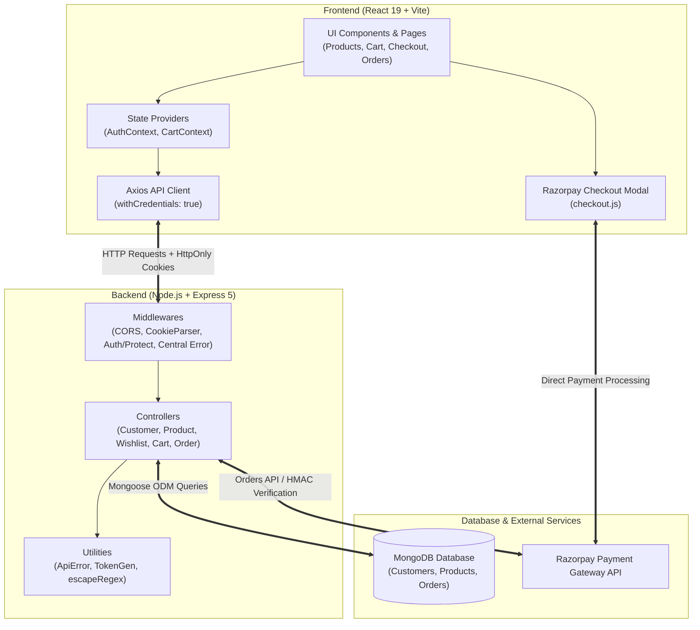

# ShopKart — Full-Stack MERN E-Commerce Platform

A production-grade, full-stack e-commerce web application built with the **MERN** stack (MongoDB, Express.js, React 19, Node.js) and bundled with **Vite**. 

Designed as a comprehensive multi-lab curriculum, **ShopKart** demonstrates modern full-stack web engineering patterns: secure stateless authentication with HttpOnly cookies, server-driven catalogue querying, atomic inventory operations, responsive UI state machines with optimistic updates, and end-to-end checkout orchestration powered by **Razorpay** with cryptographic signature verification.

---

## Table of Contents

- [Architectural Highlights](#architectural-highlights)
- [System Architecture](#system-architecture)
- [Lab Curriculum & Feature Roadmap](#lab-curriculum--feature-roadmap)
  - [Lab 01: Customer Authentication Backend](#lab-01-customer-authentication-backend)
  - [Lab 02: Frontend Authentication & Route Guarding](#lab-02-frontend-authentication--route-guarding)
  - [Lab 03: Product Catalogue & Server-Driven Discovery](#lab-03-product-catalogue--server-driven-discovery)
  - [Lab 04: Customer Wishlist & Event Synchronization](#lab-04-customer-wishlist--event-synchronization)
  - [Lab 05: Concurrency-Safe Persistent Cart](#lab-05-concurrency-safe-persistent-cart)
  - [Lab 06: Checkout, Razorpay Gateway & Order Tracking](#lab-06-checkout-razorpay-gateway--order-tracking)
- [Project Structure](#project-structure)
- [Data Models & Schemas](#data-models--schemas)
- [REST API Reference](#rest-api-reference)
- [Environment Configuration](#environment-configuration)
- [Local Setup & Installation](#local-setup--installation)
- [Postman API Testing Guide](#postman-api-testing-guide)
- [Technical Deep Dive & Viva Reference](#technical-deep-dive--viva-reference)

---

## Architectural Highlights

- **Zero External Auth SaaS**: Implements native JSON Web Token (JWT) sessions over secure, `HttpOnly`, `SameSite=Strict` cookies with salted `bcrypt` hashing (cost factor 10). No Clerk, Auth0, or Firebase dependencies.
- **Race-Condition & Concurrency Safe**: Shopping cart increments and inventory bounds are verified and applied atomically inside MongoDB using `$elemMatch`, `$inc`, and `$addToSet` rather than error-prone JavaScript read-check-save loops.
- **Price & Inventory Tamper Protection**: Order totals and line prices are calculated strictly on the backend from real-time database lookups during checkout; client-submitted totals are ignored.
- **Cryptographic Payment Integrity**: Validates payment success through HMAC SHA-256 signatures evaluated using constant-time comparison (`crypto.timingSafeEqual`) to prevent timing and replay attacks.
- **Data Snapshotting vs. References**:
  - **Wishlist & Cart**: Store lean references (`ObjectId`) to the `Product` collection to guarantee live prices and current stock.
  - **Orders**: Store immutable snapshots of item details (`name`, `price`, `image`) at the instant of transaction, preserving historical financial records even if catalogue products are modified or removed.
- **Resilient React 19 Client**:
  - Debounced search inputs (`400ms`) via custom hook.
  - Race-condition mitigation using `AbortController` cancellation for superseded network requests.
  - Derived UI loading states to prevent React 19 cascading re-render warnings.
  - Optimistic cart quantity updates with automatic rollback on network or stock failures.

---

## System Architecture



---

## Lab Curriculum & Feature Roadmap

### Lab 01: Customer Authentication Backend
- **User Registration**: Validates full name (min 3 chars), unique email formatting, password length (min 6 chars), and 10-digit phone number.
- **Password Security**: Pre-save Mongoose hook hashes passwords using `bcrypt` (10 salt rounds).
- **Session Issuance**: Generates signed JWT containing `_id` stored inside an `HttpOnly`, `SameSite=Strict` cookie (lifetime configured via `JWT_EXPIRES_IN`).
- **Data Protection**: Three-tier password stripping: `select: false` on Mongoose schema, `toJSON` transform hook, and `toPublicJSON()` instance method.
- **Account Endpoints**: Profile lookup (`GET /customers/me`), secure logout (`POST /customers/logout`), and credential updates (`PATCH /customers/change-password`).

### Lab 02: Frontend Authentication & Route Guarding
- **Context API State**: `AuthProvider` maintains customer state, exposes `login()`, `logout()`, and re-checks sessions on application load.
- **Route Guarding**:
  - `ProtectedRoute`: Wraps private views (`/home`, `/products`, `/cart`, `/checkout`, `/orders`). Shows a full-screen spinner during initialization and redirects unauthenticated visitors to `/login`.
  - `PublicRoute`: Prevents logged-in users from visiting `/login` or `/register` by redirecting to `/home`.
- **Credential Handling**: Axios configured with `withCredentials: true` to transmit cookies cross-origin.
- **Form UX**: Controlled inputs with instant client-side feedback matching server constraints.

### Lab 03: Product Catalogue & Server-Driven Discovery
- **Catalogue Schema**: Enforces non-zero positive prices (`price > 0`), non-negative integer stock (`stock >= 0`), trimmed strings, and image URLs.
- **Unified MongoDB Filter**: Evaluates `search`, `category`, and `sort` within a single backend query pipeline.
- **Security-First Search**: Regular expressions sanitized via `escapeRegex.js` to guard against ReDoS or query syntax hijacking.
- **Whitelisted Sorting**: Restricts sorting to `price_asc`, `price_desc`, `newest`, and `oldest`.
- **Frontend Discovery UI**:
  - Debounced search bar with category dropdown and price sorter.
  - Abortable network requests via `AbortController`.
  - Product details screen (`/products/:id`) displaying stock status badges (In Stock, Low Stock `< 5`, Sold Out).

### Lab 04: Customer Wishlist & Event Synchronization
- **Normalized Data Structure**: Customer documents hold an array of Product `ObjectId` references.
- **Atomic Concurrency**: Saves items using `$addToSet` guarded by `{ wishlist: { $ne: productId } }` to eliminate duplicate additions.
- **Lightweight Sync Endpoint**: `GET /wishlist/ids` fetches bare ObjectIds so the product grid can render filled heart icons without fetching full product documents.
- **Cross-Component Events**: Client event bus (`wishlistEvents.js`) coordinates heart toggles across product cards, product details, and the navbar counter.

### Lab 05: Concurrency-Safe Persistent Cart
- **Cart Data Modeling**: Embedded subdocuments on Customer: `cart: [{ product: ObjectId, quantity: Number }]`.
- **Atomic Stock Checks**:
  - `POST /cart/:productId`: Uses `$elemMatch: { product, quantity: { $lt: stock } }` and `$inc` to update existing items, or pushes a new row only when missing.
  - `PATCH /cart/:productId`: Validates requested quantity against current inventory.
- **Optimistic State Management**: `CartProvider` updates quantity in UI immediately and automatically rolls back if the server returns an error.
- **Derived Cart Metrics**: Total item count, units count, and subtotal are derived on-the-fly (`utils/cartTotals.js`) rather than stored, ensuring prices never drift.

### Lab 06: Checkout, Razorpay Gateway & Order Tracking
- **Server-Side Price Calculation**: Order pricing is derived directly from live database items. Client totals are ignored.
- **Razorpay Orders Integration**: Converts currency to paise (`amount * 100`), generates unique receipts, and returns Razorpay order IDs.
- **Cryptographic Payment Verification**: Verifies Razorpay checkout signatures (`order_id|payment_id`) against `RAZORPAY_KEY_SECRET` using `crypto.createHmac('sha256')` and `crypto.timingSafeEqual`.
- **Transactional Cart Cleanup**: Cart is emptied only after payment signature verification passes.
- **Order Timeline & Tracking**: Status progression from `PENDING_PAYMENT` to `PLACED`, `CONFIRMED`, `SHIPPED`, and `DELIVERED`. Includes development endpoint `PATCH /orders/:id/status` to simulate fulfillment.

---

## Project Structure

```text
.
├── backend/
│   ├── src/
│   │   ├── config/
│   │   │   ├── db.js                 # MongoDB connection logic
│   │   │   └── razorpay.js           # Lazy-loaded Razorpay SDK client
│   │   ├── controllers/
│   │   │   ├── cart.controller.js     # Cart updates, quantity & atomic stock rules
│   │   │   ├── customer.controller.js # Auth handlers: register, login, me, logout
│   │   │   ├── order.controller.js    # Order lifecycle, Razorpay init & verification
│   │   │   ├── product.controller.js  # Catalogue queries, search & sort
│   │   │   └── wishlist.controller.js # Wishlist toggling, listing & ID sync
│   │   ├── middlewares/
│   │   │   ├── auth.middleware.js     # JWT cookie extraction & user injection
│   │   │   └── error.middleware.js    # 404 handler & central API error parser
│   │   ├── models/
│   │   │   ├── customer.model.js      # Customer schema with embedded cart & wishlist
│   │   │   ├── order.model.js         # Order schema with frozen item snapshots
│   │   │   └── product.model.js       # Product schema with price/stock validators
│   │   ├── routes/
│   │   │   ├── cart.routes.js         # /cart routes
│   │   │   ├── customer.routes.js     # /customers routes
│   │   │   ├── order.routes.js        # /orders routes
│   │   │   ├── product.routes.js      # /products routes
│   │   │   └── wishlist.routes.js     # /wishlist routes
│   │   ├── utils/
│   │   │   ├── ApiError.js            # Custom error class & asyncHandler wrapper
│   │   │   ├── escapeRegex.js         # Escapes input for safe RegExp queries
│   │   │   ├── generateToken.js       # JWT signing & cookie configuration
│   │   │   └── seedProducts.js        # Database seeder for demo catalogue
│   │   ├── app.js                     # Express app, middleware wiring & routing
│   │   └── server.js                  # App bootstrap & HTTP listener
│   ├── .env.example                   # Backend environment template
│   ├── package.json                   # Backend dependencies & scripts
│   ├── README.md                      # Backend specific documentation
│   └── ShopKart.postman_collection.json # Postman test suite
│
├── frontend/
│   ├── public/                        # Static web assets
│   ├── src/
│   │   ├── components/
│   │   │   ├── AddToCartButton.jsx    # Stateful cart button with pending states
│   │   │   ├── AuthLayout.jsx         # Authentication split-screen layout
│   │   │   ├── CartItem.jsx           # Individual cart row with quantity controls
│   │   │   ├── FormField.jsx          # Reusable accessible form input
│   │   │   ├── Loader.jsx             # Full-screen session loading indicator
│   │   │   ├── Navbar.jsx             # Global navbar with live badges & user menu
│   │   │   ├── OrderStatus.jsx        # Order status badges & fulfillment timeline
│   │   │   ├── ProductCard.jsx        # Product display card for catalogue grid
│   │   │   ├── ProductImage.jsx       # Fallback-aware product image
│   │   │   ├── ProtectedRoute.jsx     # Auth gatekeeper for private routes
│   │   │   ├── PublicRoute.jsx        # Guest gatekeeper for login/register
│   │   │   ├── SearchBar.jsx          # Search box with category & sort selectors
│   │   │   ├── StatusBlock.jsx        # Unified loading / empty / error state box
│   │   │   ├── WishlistButton.jsx     # Heart toggle button with active states
│   │   │   └── WishlistCard.jsx       # Wishlist item display card
│   │   ├── constants/
│   │   │   └── catalog.js             # Categories, sort options & thresholds
│   │   ├── context/
│   │   │   ├── AuthContext.js         # Auth context hook & definition
│   │   │   ├── AuthProvider.jsx       # Global session manager
│   │   │   ├── CartContext.js         # Cart context hook & definition
│   │   │   └── CartProvider.jsx       # Global cart state & optimistic mutation engine
│   │   ├── hooks/
│   │   │   ├── useDebouncedValue.js   # Input debouncer hook
│   │   │   └── useWishlistIds.js      # Global wishlist state subscriber
│   │   ├── pages/
│   │   │   ├── Cart.jsx               # Shopping cart page & order summary
│   │   │   ├── Checkout.jsx           # Shipping address form & Razorpay trigger
│   │   │   ├── Home.jsx               # Customer profile overview
│   │   │   ├── Login.jsx              # Customer sign-in view
│   │   │   ├── NotFound.jsx           # 404 page
│   │   │   ├── OrderDetails.jsx       # Single order view with fulfillment tracker
│   │   │   ├── Orders.jsx             # Customer order history
│   │   │   ├── ProductDetails.jsx     # Extended product view with live stock alerts
│   │   │   ├── Products.jsx           # Product catalogue grid with filters
│   │   │   ├── Register.jsx           # New account registration view
│   │   │   └── Wishlist.jsx           # Customer saved items view
│   │   ├── services/
│   │   │   ├── api.js                 # Axios client instance & endpoint calls
│   │   │   └── wishlistEvents.js      # Global event emitter for wishlist changes
│   │   ├── utils/
│   │   │   ├── cartTotals.js          # Cart item, unit, and subtotal aggregators
│   │   │   ├── describeStock.js       # Stock level label & class resolver
│   │   │   ├── formatPrice.js         # INR currency formatter (₹)
│   │   │   ├── loadRazorpay.js        # Asynchronous Razorpay SDK injector
│   │   │   └── orderStatus.js         # Order status labels & step logic
│   │   ├── App.jsx                    # Client route definitions
│   │   ├── App.css                    # Component & page stylesheet
│   │   ├── index.css                  # Design tokens, CSS reset & base utilities
│   │   └── main.jsx                   # React root entry point
│   ├── .env.example                   # Frontend environment template
│   ├── package.json                   # Frontend dependencies & scripts
│   ├── vite.config.js                 # Vite build & server configuration
│   └── README.md                      # Frontend specific documentation
└── README.md                          # Monorepo documentation
```

---

## Data Models & Schemas

### 1. Customer (`backend/src/models/customer.model.js`)
```javascript
{
  fullName: { type: String, required: true, trim: true, minlength: 3 },
  email:    { type: String, required: true, unique: true, lowercase: true, trim: true },
  password: { type: String, required: true, minlength: 6, select: false },
  phone:    { type: String, required: true, match: /^[0-9]{10}$/ },
  wishlist: [{ type: Schema.Types.ObjectId, ref: 'Product' }],
  cart:     [{
    product:  { type: Schema.Types.ObjectId, ref: 'Product', required: true },
    quantity: { type: Number, default: 1, min: 1 }
  }],
  timestamps: true
}
```

### 2. Product (`backend/src/models/product.model.js`)
```javascript
{
  name:        { type: String, required: true, trim: true, minlength: 2 },
  description: { type: String, required: true, trim: true },
  price:       { type: Number, required: true, validate: (v) => v > 0 },
  category:    { type: String, required: true, trim: true },
  image:       { type: String, required: true, trim: true },
  stock:       { type: Number, required: true, min: 0 },
  timestamps:  true
}
```

### 3. Order (`backend/src/models/order.model.js`)
```javascript
{
  user: { type: Schema.Types.ObjectId, ref: 'Customer', required: true, index: true },
  items: [{
    product:  { type: Schema.Types.ObjectId, ref: 'Product', required: true },
    name:     { type: String, required: true },
    price:    { type: Number, required: true, min: 0 },
    quantity: { type: Number, required: true, min: 1 },
    image:    { type: String }
  }],
  shippingAddress: {
    fullName:     { type: String, required: true },
    phone:        { type: String, required: true },
    addressLine1: { type: String, required: true },
    city:         { type: String, required: true },
    state:        { type: String, required: true },
    pincode:      { type: String, required: true }
  },
  totalAmount:       { type: Number, required: true, min: 0 },
  paymentStatus:     { type: String, enum: ['PENDING', 'PAID', 'FAILED'], default: 'PENDING' },
  status:            { type: String, enum: ['PENDING_PAYMENT', 'PLACED', 'CONFIRMED', 'SHIPPED', 'DELIVERED'], default: 'PENDING_PAYMENT' },
  razorpayOrderId:   { type: String, index: true },
  razorpayPaymentId: { type: String },
  paidAt:            { type: Date },
  timestamps:        true
}
```

---

## REST API Reference

### Customer Authentication (`/customers`)

| Method | Endpoint | Auth | Description | Status Codes |
|---|---|:---:|---|---|
| `POST` | `/customers/register` | No | Register new customer account | `201`, `400`, `409` |
| `POST` | `/customers/login` | No | Authenticate credentials & issue JWT cookie | `200`, `400`, `401` |
| `GET` | `/customers/me` | Yes | Fetch active authenticated profile | `200`, `401` |
| `POST` | `/customers/logout` | Yes | Clear auth cookie | `200`, `401` |
| `PATCH`| `/customers/change-password`| Yes | Verify current password, re-hash new password | `200`, `400`, `401` |

### Product Catalogue (`/products`)

| Method | Endpoint | Auth | Query Parameters | Description | Status Codes |
|---|---|:---:|---|---|---|
| `GET` | `/products` | No | `search`, `category`, `sort` | Retrieve products (omits `description` for lightweight list) | `200`, `400` |
| `GET` | `/products/:id` | No | None | Fetch complete single product details | `200`, `400`, `404` |
| `POST` | `/products` | No | None | Create product (open for lab exercises) | `201`, `400` |

*Accepted `sort` parameters: `price_asc`, `price_desc`, `newest`, `oldest`.*

### Wishlist (`/wishlist`)

| Method | Endpoint | Auth | Description | Status Codes |
|---|---|:---:|---|---|
| `GET` | `/wishlist` | Yes | Fetch customer's populated wishlist items | `200`, `401` |
| `GET` | `/wishlist/ids` | Yes | Fetch array of saved product IDs for UI badge sync | `200`, `401` |
| `POST` | `/wishlist/:productId` | Yes | Add item to wishlist (fails if already saved) | `201`, `400`, `404`, `409` |
| `PATCH`| `/wishlist/:productId/toggle`| Yes | Atomic toggle: adds if missing, removes if present | `200`, `400`, `404` |
| `DELETE`| `/wishlist/:productId`| Yes | Remove item from wishlist | `200`, `400`, `404` |

### Shopping Cart (`/cart`)

| Method | Endpoint | Auth | Request Body | Description | Status Codes |
|---|---|:---:|---|---|---|
| `GET` | `/cart` | Yes | None | Fetch cart populated with live product details | `200`, `401` |
| `POST` | `/cart/:productId` | Yes | None | Add 1 unit or increment existing quantity | `200`, `400`, `404` |
| `PATCH`| `/cart/:productId` | Yes | `{ "quantity": 3 }` | Set specific item quantity within stock limits | `200`, `400`, `404` |
| `DELETE`| `/cart/:productId` | Yes | None | Remove item from cart | `200`, `400`, `404` |

### Orders & Razorpay Checkout (`/orders`)

| Method | Endpoint | Auth | Request Body | Description | Status Codes |
|---|---|:---:|---|---|---|
| `POST` | `/orders/create-payment-order` | Yes | `{ "shippingAddress": { ... } }` | Creates pending order & Razorpay order instance | `201`, `400`, `500`, `502` |
| `POST` | `/orders/verify-payment` | Yes | `{ "shopKartOrderId", "razorpay_order_id", "razorpay_payment_id", "razorpay_signature" }` | HMAC SHA-256 signature verification; marks order `PAID` & empties cart | `200`, `400`, `404`, `500` |
| `POST` | `/orders/:id/payment-failed` | Yes | None | Flags order as `FAILED` (cart is preserved) | `200`, `404` |
| `GET` | `/orders` | Yes | `?all=true` (optional) | Retrieves customer's paid orders (newest first) | `200`, `401` |
| `GET` | `/orders/:id` | Yes | None | Fetches single order owned by authenticated user | `200`, `401`, `404` |
| `PATCH`| `/orders/:id/status` | Yes | `{ "status": "SHIPPED" }` | Advances fulfillment stage (dev/demo only) | `200`, `400`, `404` |

---

## Environment Configuration

### Backend Configuration (`backend/.env`)

| Variable | Required | Default | Purpose |
|---|:---:|---|---|
| `PORT` | No | `5000` | Port on which the Express server listens |
| `NODE_ENV` | No | `development` | Toggles cookie `secure` flag and error stack traces |
| `MONGO_URI` | Yes | `mongodb://127.0.0.1:27017/shopkart` | MongoDB connection string (Local or MongoDB Atlas) |
| `JWT_SECRET` | Yes | — | Cryptographic secret for signing JWT tokens |
| `JWT_EXPIRES_IN` | No | `7d` | Token expiration duration |
| `CORS_ORIGIN` | No | `http://localhost:5173` | Allowed frontend origin for CORS with credentials |
| `RAZORPAY_KEY_ID` | Yes | — | Razorpay Test API Key ID (`rzp_test_...`) |
| `RAZORPAY_KEY_SECRET` | Yes | — | Razorpay Test API Key Secret |

### Frontend Configuration (`frontend/.env`)

| Variable | Required | Default | Purpose |
|---|:---:|---|---|
| `VITE_API_URL` | No | `http://localhost:5000` | Base URL of the backend API service |

---

## Local Setup & Installation

### Prerequisites
- [Node.js](https://nodejs.org/) (v18 or higher recommended)
- [MongoDB](https://www.mongodb.com/) (Local server running or a free MongoDB Atlas cluster)
- [Razorpay Account](https://razorpay.com/) (Free test mode credentials from Dashboard → Settings → API Keys)

### 1. Clone & Prepare Repository
```bash
git clone <repository-url>
cd "MERN LAB ASSIGNMENT"
```

### 2. Configure & Run Backend Server
```bash
cd backend

# Install dependencies
npm install

# Create environment configuration
cp .env.example .env
# Edit .env with your MONGO_URI, JWT_SECRET, and Razorpay test credentials

# Seed catalogue with 20 demo products across 4 categories
npm run seed

# Start server in development mode (with nodemon)
npm run dev
```
*Backend runs on `http://localhost:5000`.*

### 3. Configure & Run Frontend Application
Open a second terminal window:
```bash
cd frontend

# Install dependencies
npm install

# Create frontend environment file
cp .env.example .env

# Start Vite development server
npm run dev
```
*Frontend runs on `http://localhost:5173`.*

---

## Postman API Testing Guide

The repository includes a ready-to-run Postman collection located at `backend/ShopKart.postman_collection.json`.

### How to Import & Run
1. Open Postman and click **Import** in the top left.
2. Select `backend/ShopKart.postman_collection.json`.
3. Ensure Postman cookie management is enabled (default behavior). Postman will automatically capture the `token` cookie returned by `POST /customers/login` and attach it to subsequent protected requests.
4. The collection uses variables:
   - `{{baseUrl}}`: Defaults to `http://localhost:5000`.
   - `{{productId}}`: Populated automatically by the test script in the **Create Product** request.

### Recommended Execution Flow
1. **Customer Auth (Lab 01)**:
   - Run `1. Register` (creates account).
   - Test error cases: `1b. Duplicate email (409)`, `1c. Short password (400)`, `1d. Missing field (400)`.
   - Run `2. Login` (saves auth cookie).
   - Run `3. My Profile` (validates `GET /customers/me`).
   - Run `5. Change Password` (updates password and cycles session).
   - Run `4. Logout` (invalidates session cookie).
2. **Products (Lab 03)**:
   - Run `1. Create Product` (extracts `_id` into `{{productId}}`).
   - Run `2. Get All Products`, followed by query filter variants (`search`, `category`, and `sort`).
   - Run `4. Get Single Product` using `{{productId}}`.
3. **Cart (Lab 05)**:
   - Run `0. Login first` to re-authenticate.
   - Run `1. Add new item` (quantity 1) → `2. Add same item again` (quantity 2).
   - Run `3. Get Cart` to verify populated product details.
   - Run `4. Update quantity` and check stock boundary rejections.
   - Run `6. Remove item` to verify cart cleanup.

---

## Technical Deep Dive & Viva Reference

### 1. Authentication & Security
- **Why `bcrypt` instead of two-way encryption?**
  Encryption is reversible if the encryption key is compromised. Hashing is a one-way mathematical function. `bcrypt` salts each password with random data to nullify precomputed rainbow table attacks and applies an adaptive work factor (iterations) to make hardware brute-force attacks computationally prohibitive.
- **Why store JWTs in `HttpOnly` cookies instead of `localStorage`?**
  Data stored in `localStorage` is accessible to client-side JavaScript via `window.localStorage`. If the site suffers from a Cross-Site Scripting (XSS) vulnerability, malicious scripts can read and exfiltrate the access token. `HttpOnly` cookies are inaccessible to JavaScript (`document.cookie` cannot view them), isolating the session credential from script injection.
- **Why configure `SameSite=Strict` and CORS `credentials: true`?**
  `SameSite=Strict` guarantees the browser will never attach the cookie on cross-site requests, providing defense against Cross-Site Request Forgery (CSRF). When making cross-origin requests (`localhost:5173` to `localhost:5000`), `cors({ credentials: true })` and `withCredentials: true` instruct the browser to allow cookie transmission, requiring an explicit, non-wildcard `origin`.
- **What belongs in a JWT payload?**
  Only non-sensitive identifiers, such as the customer's MongoDB `_id` and standard claims (`iat`, `exp`). JWT payloads are Base64Url-encoded strings—not encrypted—meaning anyone who intercepts the token can read its payload. Passwords, hashes, or personal data must never be placed inside a JWT payload.

### 2. Catalogue & Search Performance
- **Why execute product filtering on the server instead of the browser?**
  Fetching all products to filter client-side forces the browser to download unnecessary data over the wire. While manageable for 20 items, this degrades network and memory performance with thousands of items. Server-side querying allows MongoDB to utilize indexes and transmit only the requested subset.
- **URL Parameters vs. Query Parameters:**
  - **URL Parameters (`/products/:id`)**: Represent resource identity. A different ID addresses a different resource.
  - **Query Parameters (`/products?category=Electronics&sort=price_asc`)**: Represent resource modifiers. The underlying collection remains the same, but the representation is filtered or sorted.

### 3. Concurrency & Cart Integrity
- **How does ShopKart prevent race conditions when updating inventory?**
  Traditional application-level validation ("read stock from DB -> check if stock > qty in JS -> save to DB") is susceptible to race conditions under concurrent requests. ShopKart uses atomic MongoDB query operators:
  ```javascript
  Customer.updateOne(
    { _id: userId, "cart.product": productId, "cart.quantity": { $lt: productStock } },
    { $inc: { "cart.$.quantity": 1 } }
  )
  ```
  The condition and write occur atomically inside the database engine, ensuring inventory cannot be oversold regardless of concurrent incoming requests.

### 4. Payments & Financial Transactions
- **Why recalculate order totals on the server instead of accepting client calculations?**
  Client-side HTTP payloads can be easily intercepted and altered. If the server accepted `{ totalAmount: 1 }` from the client request body, an attacker could purchase expensive products for negligible amounts. The server retrieves active prices from the database, sums them, and generates the Razorpay order accordingly.
- **How does Razorpay cryptographic signature verification work?**
  When a payment completes, Razorpay returns `razorpay_order_id`, `razorpay_payment_id`, and `razorpay_signature`. The backend computes:
  ```javascript
  const expected = crypto
    .createHmac("sha256", process.env.RAZORPAY_KEY_SECRET)
    .update(`${order.razorpayOrderId}|${razorpayPaymentId}`)
    .digest("hex");
  ```
  Because only Razorpay and our backend hold `RAZORPAY_KEY_SECRET`, a valid HMAC signature proves the payment was legitimately processed by Razorpay for that specific order.
- **Why use `crypto.timingSafeEqual` for signature comparisons?**
  Standard string comparisons (`a === b`) short-circuit on the first mismatched character, creating subtle differences in execution time. Attackers can exploit these timing discrepancies to deduce the valid signature character-by-character. Constant-time comparison ensures identical execution duration regardless of matching content.
- **Why snapshot product data inside the Order schema?**
  Cart items store references (`ObjectId`) because users need to see current prices and real-time inventory before purchasing. Once an order is placed, it represents a legal and financial transaction. The Order schema stores copies of the product name, price, and image at that exact moment so future catalogue price adjustments or deletions do not alter past order records.
